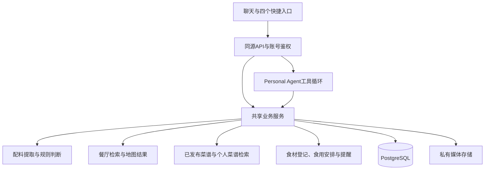

# 项目架构

产品以一个Personal Agent承接对话，四个工具入口提供直接操作方式。当前没有把四项功能拆成独立运行的多个Agent；开发过程使用的协作Agent也不属于产品运行架构。

- `frontend/app`承载页面与整体布局，`components`负责交互，`lib`保存接口封装和状态处理。
- `backend/app/agent.py`负责有界工具调用；业务服务由对话和快捷入口共用。
- `backend/app/services`处理餐厅、菜谱、食材、草稿和确认操作；独立规则负责三类素食适配。
- PostgreSQL保存账号隔离的数据。上传媒体通过鉴权接口访问，不能放入前端静态目录。
- 语音先由浏览器采音，后台任务调用转写服务，再经既有聊天路径提交。明确的附近查询可以获取本次位置后续查，历史恢复不会主动重新定位。
- 食材登记支持信息不完整的轻量记录。食用安排与正式包装到期日分开；系统提醒需用户明确设置，推送需设备授权和HTTPS。

服务端持有模型、高德Web服务、安全密钥和转写Key。开发默认关闭外部调用，所有供应商费用和请求次数均需单独限制。模型返回、网页来源和工具结果是数据，不应作为越过鉴权或直接写库的指令。

生产准备采用Caddy同源入口、前端、单实例API与私有PostgreSQL。容器构建、HTTPS、持久卷、备份恢复和手机端尚需实际部署验证。
